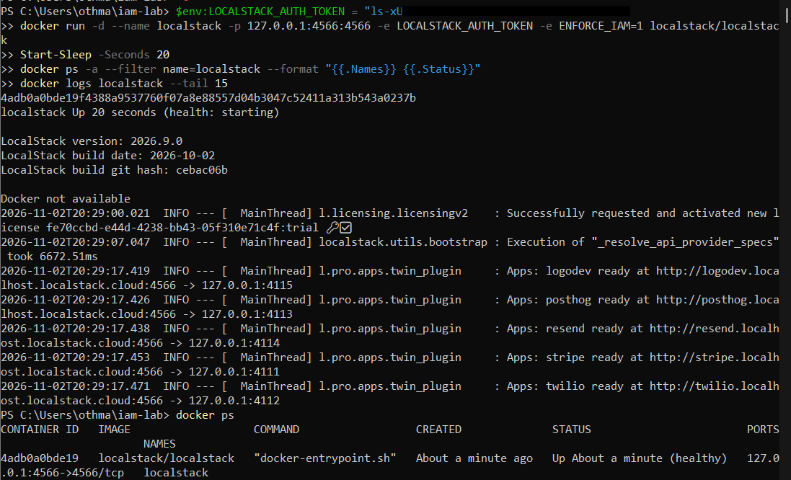
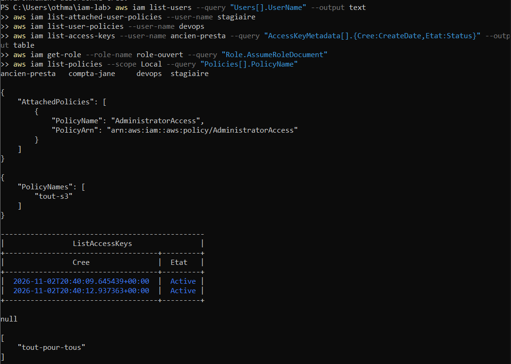
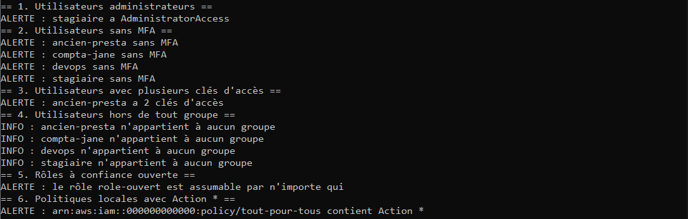
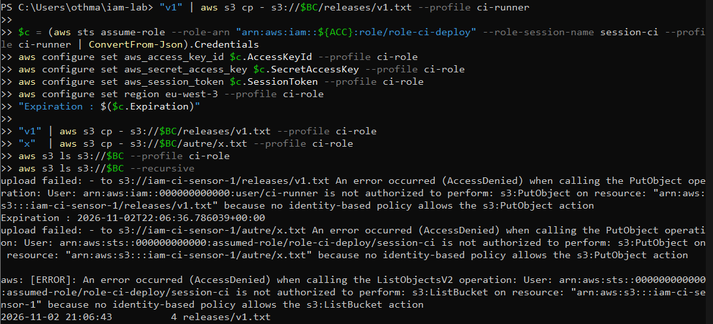
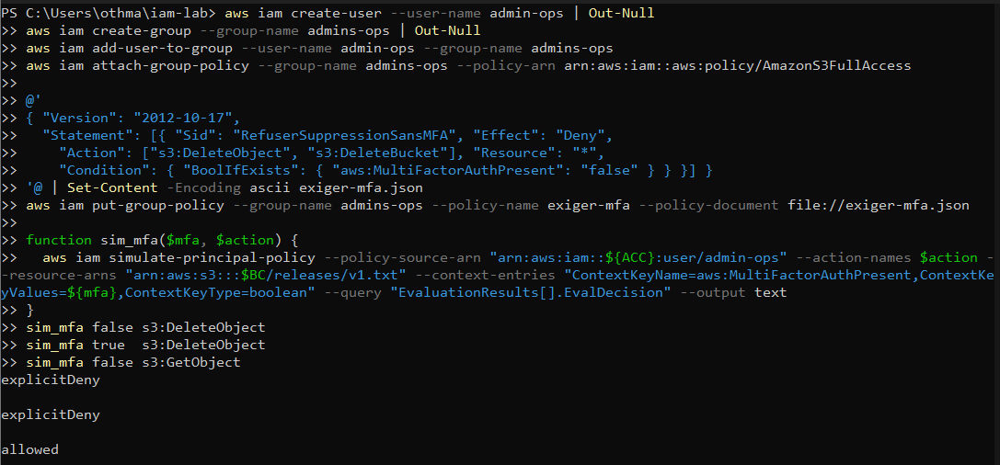
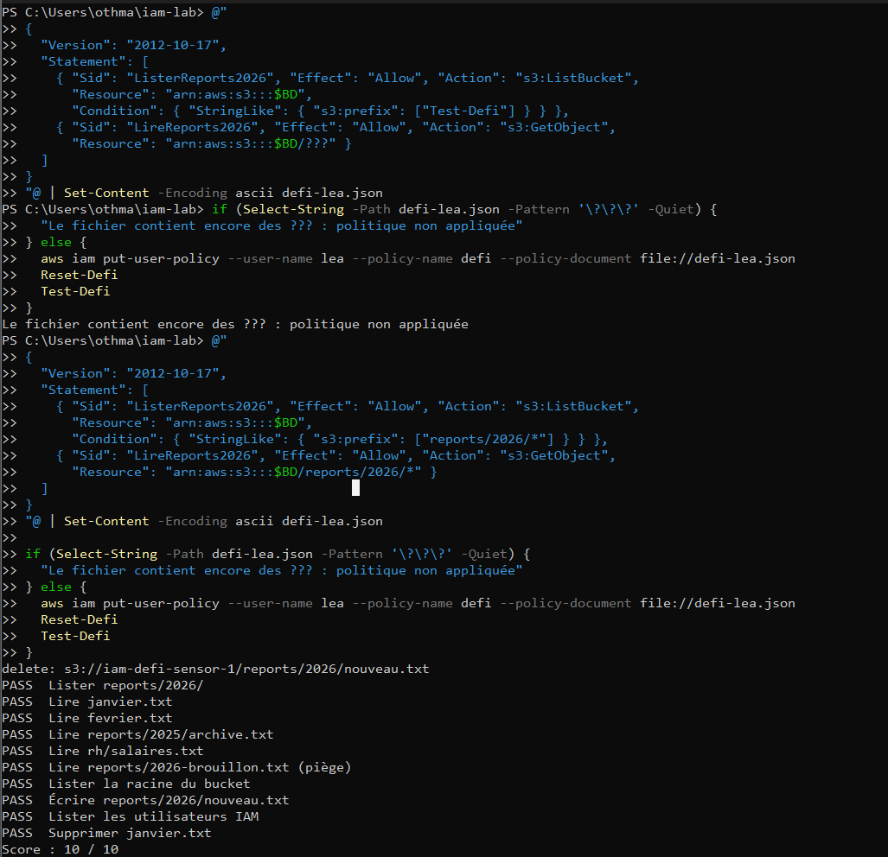
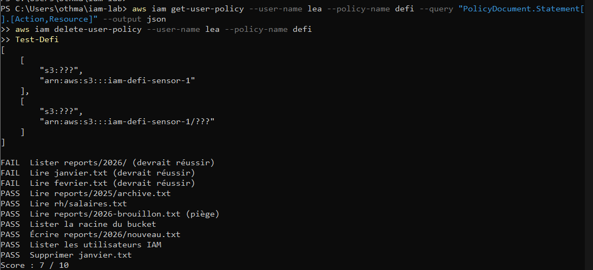

# Audit IAM et moindre privilège : constats, compte de service et politique minimale


Auditer un environnement IAM volontairement désordonné, formuler des constats priorisés comme dans une mission de conseil, mettre en place un compte de service au moindre privilège, protéger une action sensible par le MFA, puis écrire une politique minimale validée par des tests. Le dépôt montre le raisonnement et les limites autant que les commandes.

## Synthèse de restitution

- **Contexte :** environnement de test local qui reproduit des défauts fréquents en audit d'accès.
- **Constat principal :** 7 alertes automatiques et 4 informations, dont 2 critiques : un stagiaire administrateur et un rôle assumable par n'importe quelle identité AWS. Le script ne voit pas deux comptes aux droits trop larges mais sans joker total.
- **Priorités :** retirer les droits d'administration superflus et fermer le rôle ouvert (effort faible), supprimer les clés en double, imposer le MFA, regrouper les droits par fonction.
- **Preuve de faisabilité :** un pipeline sans droit direct dépose uniquement dans `releases/` grâce à un rôle d'une heure, et une analyste lit uniquement `reports/2026/` (10 tests sur 10 : 3 autorisés, 7 refusés).
- **Réserve :** le simulateur de l'émulateur ignore la condition MFA. Ce point doit être validé sur un compte de test AWS avant toute recommandation ferme.

## En bref

| | |
|---|---|
| **Objectif** | Passer de l'audit à la correction : constats, compte de service, MFA, politique minimale |
| **Environnement** | LocalStack avec application des permissions (`ENFORCE_IAM=1`), publié sur `127.0.0.1:4566` uniquement |
| **Données** | Deux buckets de test et des fichiers fictifs |
| **Outils** | AWS CLI v2, PowerShell, Docker, simulateur de politiques IAM |
| **Approche** | Constat, preuve, risque, gravité, recommandation, effort ; tests autorisés et refusés |

## Périmètre et hypothèses

Tout se déroule en local, sans compte AWS réel : identifiants `test` fictifs, compte `000000000000`, aucun secret versionné. Le token de l'émulateur est saisi sans écho et jamais écrit.

Hypothèses de travail, à valider avec un client réel : les cinq utilisateurs sont des comptes de personnes ou de services existants, et aucun besoin métier n'est documenté pour les droits larges de `devops` et `compta-jane`. C'est la première question à poser en entretien : qui utilise ce compte, pour quoi, et depuis quand ?

## Constats d'audit

Preuves : [audit manuel](docs/images/02-audit-manuel.png) et [audit automatisé](docs/images/03-audit-automatise.png).

| # | Constat | Identité | Risque métier | Gravité | Recommandation | Effort |
|---|---|---|---|---|---|---|
| 1 | Droits d'administrateur | `stagiaire` | Un compte compromis donne le contrôle total du compte cloud | Critique | Retirer `AdministratorAccess`, passer par un groupe aux droits nécessaires | Faible |
| 2 | Rôle assumable par n'importe qui, avec droits d'administrateur | `role-ouvert` | Toute identité AWS peut devenir administrateur | Critique | Limiter `Principal` à une identité précise, retirer l'administration | Faible |
| 3 | Politique avec `Action: *` | `tout-pour-tous` | Non attachée aujourd'hui : un seul rattachement suffit pour ouvrir tous les droits | Élevée (latente) | La supprimer, écrire une politique ciblée si un besoin existe | Faible |
| 4 | Deux clés d'accès actives | `ancien-presta` | Compte probablement abandonné avec deux secrets valides non surveillés | Élevée | Désactiver puis supprimer les clés, supprimer le compte | Faible |
| 5 | Absence de MFA | `ancien-presta`, `compta-jane`, `devops`, `stagiaire` | Un mot de passe volé suffit pour entrer | Élevée (administrateur), moyenne (autres) | Imposer le MFA, supprimer les mots de passe console inutiles | Moyen |
| 6 | Droits larges sans joker total | `devops` (`s3:*`), `compta-jane` (`s3:Get*`, `s3:List*`) | Accès à tous les buckets, invisible du test « Action * » | Moyenne | Cibler les buckets et préfixes après recueil du besoin | Moyen |
| 7 | Utilisateurs hors de tout groupe | Les quatre utilisateurs | Droits difficiles à relire et à révoquer | Faible (hygiène) | Un groupe par fonction, droits portés par le groupe | Moyen |

Formulations pour un client non technique :

- **Rôle ouvert :** « Aujourd'hui, n'importe quelle identité AWS peut endosser ce rôle et obtenir tous les droits. C'est comme laisser la clé du bâtiment sur la porte. »
- **Clés multiples :** « Ce compte a deux accès valides alors que son titulaire est parti : personne ne surveille ces accès, et ils peuvent servir à entrer. »
- **MFA :** « Sans second facteur, un mot de passe volé suffit. Avec un second facteur, il faut aussi le téléphone. »

## Méthodologie et résultats

### 1. Démarrer et prouver que les refus sont réels

Script : [`scripts/01-demarrer-localstack.ps1`](scripts/01-demarrer-localstack.ps1).



Un compte sans aucun droit doit recevoir `AccessDenied`. Si l'action réussit, les permissions ne sont pas appliquées et tous les tests suivants ne prouveraient rien.

**Lecture consultant :** avant d'auditer, vérifier que l'outil de mesure fonctionne. Un contrôle qui n'a jamais refusé ne démontre rien.

### 2. Audit manuel puis automatisé

Scripts : [`02-environnement-desordonne.ps1`](scripts/02-environnement-desordonne.ps1) et [`03-audit-iam.ps1`](scripts/03-audit-iam.ps1). Le premier est protégé : il refuse de s'exécuter hors de l'émulateur.




Le regard manuel vient en premier : utilisateurs, politiques rattachées, clés, confiance des rôles. Puis le script contrôle six indicateurs : administrateurs, absence de MFA, clés multiples, absence de groupe, rôles à confiance ouverte, politiques avec `Action: *`.

**Lecture consultant :** un audit automatisé ne remplace pas la lecture humaine. Ici, il manque `devops` et `compta-jane` : les angles morts d'un outil font partie du rapport.

### 3. Compte de service au moindre privilège

Script : [`04-compte-service-et-mfa.ps1`](scripts/04-compte-service-et-mfa.ps1), partie A.



| Test | Résultat |
|---|---|
| Dépôt direct par le compte de service | Refusé |
| Dépôt dans `releases/` via le rôle | Autorisé |
| Dépôt ailleurs via le rôle | Refusé |
| Listage via le rôle | Refusé |
| Contrôle administrateur | Seul `releases/v1.txt` existe |

Le rôle n'accorde que `s3:PutObject` sur `releases/*` et expire au bout d'une heure.

**Lecture consultant :** le maillon faible est la clé permanente du compte de service. Question à poser au client : où s'exécute le pipeline ? Un rôle attaché à la machine ou la fédération OpenID Connect supprime ce secret.

### 4. MFA : règle écrite, validation incomplète

Script : [`04-compte-service-et-mfa.ps1`](scripts/04-compte-service-et-mfa.ps1), partie B.



| Série de simulations | MFA = false | MFA = true |
|---|---|---|
| `BoolIfExists`, type `boolean` | explicitDeny | explicitDeny |
| `Bool`, type `boolean` | allowed | allowed |
| `BoolIfExists`, type `string` | explicitDeny | explicitDeny |

Sous AWS, la suppression avec MFA devrait être autorisée. Les trois séries sont cohérentes avec un simulateur qui ignore la clé MFA. La condition reste `BoolIfExists` : avec `Bool` seul, une clé d'accès permanente, qui ne porte aucune information MFA, contournerait la règle.

**Lecture consultant :** annoncer au client ce qui est démontré (le refus sans MFA) et ce qui ne l'est pas (l'autorisation avec MFA). Une limite documentée est plus crédible qu'un résultat arrangé.

### 5. Cas pratique : politique minimale pour une analyste

Script : [`05-validation-politique-lea.ps1`](scripts/05-validation-politique-lea.ps1) et politique [`lecture-reports-2026.json`](policies/lecture-reports-2026.json).



Léa doit lire uniquement `reports/2026/` : ni écrire, ni supprimer, ni lire ailleurs, ni consulter IAM. Avant la politique, le score est de 7 sur 10 (les sept refus passent). Après, il est de 10 sur 10.

Le piège : `reports/2026-brouillon.txt` commence comme `reports/2026/`. La barre finale du préfixe l'exclut ; sans elle, le brouillon serait lisible.

**Lecture consultant :** une politique se valide par des tests de refus autant que de réussite. Une politique minimale se reconnaît à ce qu'elle ne contient que ce dont le besoin exprimé a strictement besoin.

## Incident : une politique incomplète ouvre tous les droits

Une première version de la politique, restée avec des marqueurs de remplacement (`???`), a été appliquée par erreur. Résultat : 3 sur 10, Léa pouvait tout faire, y compris interroger IAM, supprimer un fichier et en créer un. Le retrait de la politique a ramené le score à 7 sur 10, ce qui confirme le lien de cause à effet. Les données ont été restaurées par `Reset-Defi`.



Leçons : l'émulateur s'est montré permissif devant une politique mal formée (hypothèse, cause non vérifiée) ; les tests de refus ont détecté ce que des tests de réussite auraient laissé passer ; un test destructif demande une fonction de remise en état ; et un fichier de configuration qui contient encore un marqueur de remplacement ne doit pas être déployé.

## Limites

- L'environnement est émulé : le comportement peut différer d'un compte AWS réel.
- La condition MFA n'est validée qu'au simulateur, qui ignore cette clé : l'autorisation avec MFA n'est pas démontrée.
- Le comportement d'AWS devant des jokers `?` dans une politique incomplète n'a pas été testé.
- L'audit repose sur six motifs ; tout droit excessif hors de ces motifs lui échappe.
- Aucune journalisation d'audit n'est exploitée dans ce dépôt.
- Les horodatages sont en UTC.

## Recommandations et vision d'architecte

| Priorité | Recommandation | Effort |
|---|---|---|
| P1 | Retirer `AdministratorAccess` du stagiaire et fermer `role-ouvert` | Faible |
| P1 | Désactiver puis supprimer les clés et le compte d'`ancien-presta` | Faible |
| P1 | Imposer le MFA par `Deny` conditionnel (`BoolIfExists`) sur les actions sensibles, puis le valider sur un compte de test AWS | Moyen |
| P2 | Remplacer la clé permanente du pipeline par une identité de plateforme ou la fédération OpenID Connect | Moyen à élevé |
| P2 | Remplacer les politiques rattachées aux utilisateurs par des politiques de groupe ciblées, après recueil du besoin | Moyen |
| P2 | Supprimer `tout-pour-tous` et ajouter à l'audit des contrôles sur les droits larges (`s3:*`, `Get*`, `List*`) | Faible |
| P3 | Journaliser et alerter sur `AssumeRole`, `CreateAccessKey`, `AttachUserPolicy` et les rafales d'`AccessDenied` | Moyen |
| P3 | Automatiser des tests de politiques sur le modèle de `Test-Defi` avant tout déploiement | Moyen |

Feuille de route indicative : sous 30 jours, les actions P1 à effort faible ; sous 60 jours, le MFA et le recueil des besoins pour les droits larges ; sous 90 jours, le pipeline sans clé permanente, la journalisation et les tests automatisés.

## Compétences de consultant démontrées

| Compétence | Où la voir |
|---|---|
| Cadrer un périmètre et poser des hypothèses | Périmètre et hypothèses |
| Auditer et apporter des preuves | Constats d'audit, captures 02 et 03 |
| Qualifier et prioriser (gravité, effort) | Tableau des constats, recommandations |
| Reformuler pour un client non technique | Synthèse de restitution, formulations client |
| Tester rigoureusement, y compris les refus | Cas pratique, score 10 sur 10 |
| Reconnaître les limites d'un outil | MFA, incident, limites |
| Automatiser et sécuriser les secrets | Scripts, saisie du token sans écho |

## Correspondance avec les référentiels (indicative)

À confirmer avant usage en mission. D'après le mappage de l'outil Prowler observé dans un projet précédent : le contrôle d'accès et la gestion des droits relèvent de l'annexe A.5.15 de la norme ISO/IEC 27001:2022 ; le MFA relève de A.5.17 (informations d'authentification) et A.8.5 (authentification sécurisée).

## Reproduire

1. Démarrer l'environnement : `scripts/01-demarrer-localstack.ps1`.
2. Créer le désordre, puis l'auditer : `scripts/02-environnement-desordonne.ps1`, `scripts/03-audit-iam.ps1`.
3. Compte de service et MFA : `scripts/04-compte-service-et-mfa.ps1`, depuis la racine du dépôt.
4. Politique minimale : `scripts/05-validation-politique-lea.ps1`, depuis la racine du dépôt.
5. Nettoyer : arrêter et supprimer le conteneur, supprimer les profils de test de `~/.aws/credentials` et `~/.aws/config`, régénérer le token.

## Structure du dépôt

```text
.
├── README.md
├── policies/      cinq politiques JSON
├── scripts/       cinq scripts PowerShell numérotés
└── docs/images/   captures numérotées
```

## Autres projets

- [aws-iam-policies-rbac-abac-lab](https://github.com/othmane71-art/aws-iam-policies-rbac-abac-lab) : politiques RBAC, rôle temporaire et ABAC
- [aws-iam-identities-least-privilege-lab](https://github.com/othmane71-art/aws-iam-identities-least-privilege-lab) : identités IAM, refus par défaut, MFA et inventaire
- [cloud-exposure-audit-nmap-zap-prowler](https://github.com/othmane71-art/cloud-exposure-audit-nmap-zap-prowler) : audit d'exposition et de posture cloud
- [ARCHISOC-LAB-HOME](https://github.com/othmane71-art/ARCHISOC-LAB-HOME) : architecture SOC virtualisée
- [Microsoft-Sentinel-SOC-Lab](https://github.com/othmane71-art/Microsoft-Sentinel-SOC-Lab) : SOC hybride avec Microsoft Sentinel
